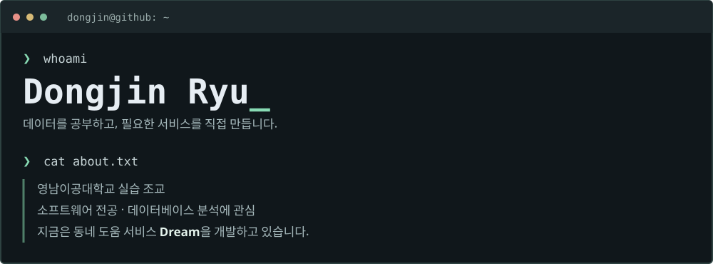

<a href="#경력">Experience</a> · <a href="#프로젝트와-활동">Projects</a> · <a href="#학력">Education</a> · <a href="#contact">Contact</a>

## 경력

| 기간 | 소속·역할 | 맡은 일 |
| :--- | :--- | :--- |
| 2025.10 — 현재 | **영남이공대학교 · 실습 조교** | 실습실 컴퓨터·노트북·영상 장비 유지보수 및 관리, 실습 지원과 행정 업무 |

## 프로젝트와 활동

### Dream · 동네 도움 서비스
**2026.09 — 11 · 모두의 창업 1R**

가까운 이웃과 분실물을 찾고 생활 속 도움을 주고받는 웹·앱 시제품입니다.
게시글 작성부터 채팅, 사례금 예치, 완료 증빙과 인수확인까지 이어지는 흐름을 구현했습니다.

`TypeScript` `React Native` `Expo`

### 자동 신고 소화기 받침대 플랫폼
**2024.03 — 06 · 캡스톤 디자인 · 팀장**

플랫폼 개발을 맡아 팀을 이끌고, 교내 캡스톤 디자인 작품 발표회에서 시연·발표했습니다.

### 데이터로 보는 야마모토 요시노부
구종별 무브먼트와 이닝별 구속 변화를 살펴본 분석 프로젝트입니다.

## 학력

| 기간 | 학교·전공 | 학위·학점 |
| :--- | :--- | :--- |
| 2025.03 — 2026.02 | **영남이공대학교** 소프트웨어콘텐츠학과 전공심화과정 | 학사 졸업 **4.37 / 4.5 · 수석** |
| 2019.03 — 2025.02 | **영남이공대학교** 소프트웨어콘텐츠계열 소프트웨어전공 | 전문학사 졸업 4.08 / 4.5 |

## 자격·교육

| SQLD | 정보처리기사 | Google AI Essentials |
| :--- | :--- | :--- |
| SQL 개발자 2025.09 취득 | **필기 합격** 2025.06 | 교육 수료 2025.07 |

## 사용 기술

**앱·웹 개발**  
`TypeScript` `React Native` `Expo` `Git`

**데이터 분석**  
`Python` `R` `SQL` `Excel`

## Contact

[d0ng_j1n@naver.com](mailto:d0ng_j1n@naver.com)
